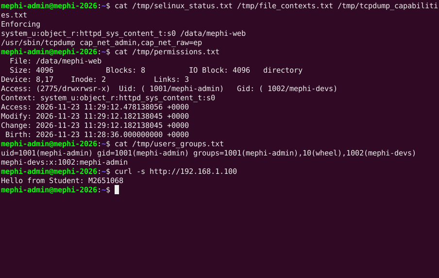
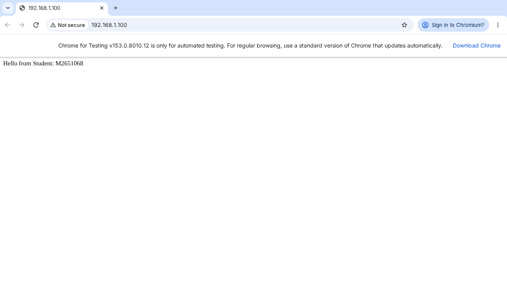
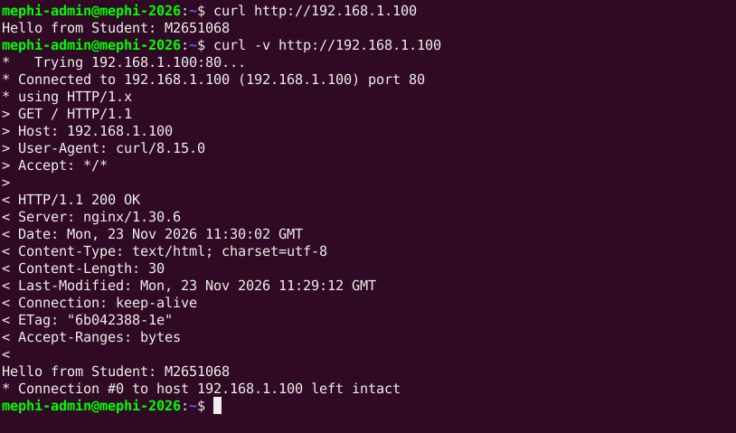
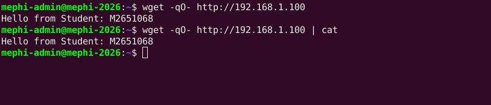
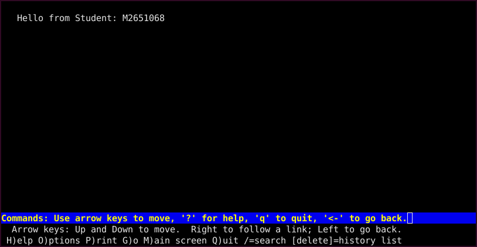

# Сессионный проект — Операционные системы семейства Unix - `Денис Губарев`


> **Тестовая сборка, не результаты сдачи.** Все файлы и скриншоты в этой ветке получены, когда Claude (ИИ-ассистент)
> прогнал `project_setup.sh` с параметрами из ТЗ (`sudo DISK=/dev/sdb bash project_setup.sh`) на тестовой ВМ:
> чистая Fedora 43 x86_64 в QEMU, SELinux Enforcing, второй диск `/dev/sdb`, IP `192.168.1.100/24`, шлюз `192.168.1.1`,
> DNS `8.8.8.8`. Скриншоты сняты на виртуальном дисплее: терминал xterm с SSH-сессией `mephi-admin` на тестовую ВМ
> и браузер Chromium, который открывает nginx этой ВМ по адресу `192.168.1.100`.
> Отличия от реальной ВМ:
> * у тестового окружения нет выхода в интернет по ICMP, поэтому ping до `8.8.8.8` в `network_check.txt` показывает
>   потери и дубликаты пакетов (артефакт эмуляции сети QEMU); ping до шлюза `192.168.1.1` проходит без потерь;
> * интерфейс называется `enp0s3`, подключение — `cloud-init enp0s3` (в эталоне `eth0`).
>
> Полный вывод прогона лежит в `test_run.log`.

| | |
|---|---|
| **Студент** | Губарев Денис |
| **Зачётная книжка** | М2651068 |
| **Группа** | М26-555 |
| **Подразделение** | Институт интеллектуальных кибернетических систем (ИИКС) |
| **Направление** | 01.04.02 «Прикладная математика и информатика» |
| **Образовательная программа** | «Обработка данных и применение искусственного интеллекта» (кафедра 42) |
| **Форма обучения** | очная |
| **ОС** | Fedora 43 (минимальная установка) |
| **Hostname** | mephi-2026.domain.local |
| **IP адрес** | 192.168.1.100 |

## Файлы проекта

| Файл | Раздел | Что проверяется |
|------|--------|----------------|
| `project_history.txt` | Все | История всех выполненных команд |
| `network_check.txt` | 1.2 | Результаты ping до шлюза и 8.8.8.8 |
| `nginx_recent_logs.txt` | 3.2 | Логи сервиса nginx за 5 минут |
| `fstab.txt` | 3.1 | Автомонтирование LABEL=MEPHI_DATA |
| `selinux_status.txt` | 4.2 | Режим SELinux = Enforcing |
| `file_contexts.txt` | 4.2 | Контекст SELinux = httpd_sys_content_t |
| `tcpdump_capabilities.txt` | 4.2 | cap_net_raw,cap_net_admin+ep |
| `permissions.txt` | 4.1 | Права 2775, владелец mephi-admin:mephi-devs |
| `users_groups.txt` | 4.1 | Пользователь mephi-admin, группа mephi-devs |
| `index.html` | 5.2 | Hello from Student: М2651068 |
| `curl_output.txt` | 5.2 | Результат curl http://192.168.1.100 |
| `mephi-nginx-screenshot.png` | 5.2 | Скриншот работающего nginx |
| `mephi-nginx-screenshot_1_browser.png` | 5.2 | Скриншот работающего nginx в браузере |
| `mephi-nginx-screenshot_2_curl.png` | 5.2 | Скриншот работающего nginx curl |
| `mephi-nginx-screenshot_3_wget.png` | 5.2 | Скриншот работающего nginx wget |
| `mephi-nginx-screenshot_4_lynx.png` | 5.2 | Скриншот работающего nginx lynx |
| `tcpdump-4.99.6-2.fc43.*.rpm` | 2.2 | Локальный RPM-пакет tcpdump |
| `project_setup.sh` | Все | Скрипт со всеми командами проекта (дополнительно) |
| `test_run.log` | Все | Полный вывод тестового прогона скрипта (дополнительно) |

## Краткий отчёт по разделам

### Раздел 1 — Управление сетью 

Настроен статический IP **192.168.1.100/24** через `nmcli`, шлюз **192.168.1.1**, DNS **8.8.8.8**.  
Установлено имя хоста **mephi-2026.domain.local** через `hostnamectl`.  
Проверена сетевая связность: маршрут по умолчанию ведёт на 192.168.1.1, до шлюза и до 8.8.8.8 потерь пакетов нет (0%).

```
nmcli connection modify eth0 ipv4.method manual \
  ipv4.addresses 192.168.1.100/24 \
  ipv4.gateway 192.168.1.1 \
  ipv4.dns 8.8.8.8

hostnamectl set-hostname mephi-2026.domain.local
ip route show default
ping -c 4 192.168.1.1 > ~/network_check.txt
ping -c 4 8.8.8.8 >> ~/network_check.txt
```

### Раздел 2 — Управление программным обеспечением 

Установлены пакеты через `dnf install`: **nginx**, **tcpdump**, **libcap-ng-utils**.  
Пакет tcpdump скачан через `dnf download` и установлен через `rpm -ivh`:

```
dnf install -y nginx tcpdump libcap-ng-utils
dnf download --destdir=/tmp tcpdump
rpm -ivh --replacepkgs /tmp/tcpdump-4.99.6-2.fc43.*.rpm
```

### Раздел 3 — Файловые системы и сервисы 

На диске `/dev/sdb` создан раздел GPT, отформатирован в **ext4** с меткой **MEPHI_DATA**.  
Настроено автомонтирование в `/data/mephi-web` через `/etc/fstab`.  
Сервис **nginx** запущен и добавлен в автозапуск, логи за последние 5 минут сохранены через `journalctl`.

```
parted /dev/sdb --script mklabel gpt mkpart primary ext4 0% 100%
mkfs.ext4 -L MEPHI_DATA /dev/sdb1
mkdir -p /data/mephi-web
echo "LABEL=MEPHI_DATA  /data/mephi-web  ext4  defaults  0 2" >> /etc/fstab
mount -a
systemctl enable --now nginx
journalctl -u nginx --since "5 minutes ago" > ~/nginx_recent_logs.txt
```

### Раздел 4 — Управление доступом 

Создан пользователь **mephi-admin**, группа **mephi-devs**.  
Директория `/data/mephi-web`: владелец `mephi-admin:mephi-devs`, права **2775** (setgid).  
SELinux работает в режиме **Enforcing**, контекст директории — `httpd_sys_content_t`.  
Для tcpdump убран SUID-бит, добавлены capabilities **cap_net_raw,cap_net_admin+ep**.

```
useradd -m -s /bin/bash mephi-admin
groupadd mephi-devs
echo "mephi-admin:P@ssw0rd2026" | chpasswd
usermod -aG mephi-devs mephi-admin
chown mephi-admin:mephi-devs /data/mephi-web
chmod 2775 /data/mephi-web
semanage fcontext -a -t httpd_sys_content_t "/data/mephi-web(/.*)?"
restorecon -Rv /data/mephi-web
chmod u-s /usr/sbin/tcpdump
setcap cap_net_raw,cap_net_admin+ep /usr/sbin/tcpdump
sudo -u mephi-admin tcpdump --help
```

### Раздел 5 — Аутентификация и тестирование 

Вход `root` заблокирован через **PAM** (`pam_listfile.so`) и `PermitRootLogin no` в sshd.  
Создана веб-страница `/data/mephi-web/index.html` (от имени `mephi-admin`), nginx отдаёт её в кодировке UTF-8 (`charset utf-8;`).  
Сервер доступен по `http://192.168.1.100`.

```
echo "root" > /etc/ssh/denied_users
# В /etc/pam.d/login и /etc/pam.d/sshd добавлена строка:
# auth required pam_listfile.so onerr=succeed item=user sense=deny file=/etc/ssh/denied_users
echo "PermitRootLogin no" > /etc/ssh/sshd_config.d/10-deny-root.conf
sudo -u mephi-admin bash -c "echo 'Hello from Student: М2651068' > /data/mephi-web/index.html"
curl http://localhost
curl http://192.168.1.100
```

Результат:
```
Hello from Student: М2651068
```

## Скриншоты

nginx работает

browser

curl

wget

lynx

